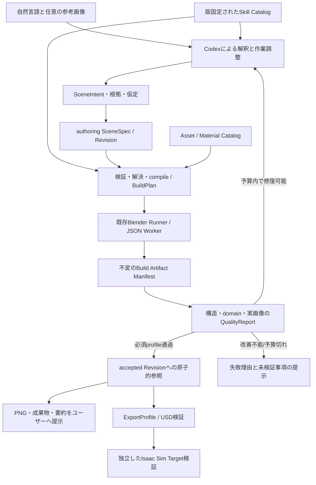

# Phase 1.5 — 最終目標に対するアーキテクチャレビュー

レビュー日: 2026-11-15 (America/New_York)。対象コミット:
`3c81016716244133cc19b45b29e452224e11b6ff`。
Git管理対象の変更は本レビュー文書だけで、実装、既存仕様、テスト、依存設定は変更していない。
レビュー用のテストログと観察結果はartifacts以下に新規保存し、コミット対象に含めない。
以下は提案であり、Phase 2以降の設計変更を実施済みという意味ではない。

## 1. 結論と最終目標への適合性

**推奨は「部分的な設計修正」。Phase 0・1のやり直し、システム全体の作り直しは不要。**

現在は「検証済みの小さなシーンを安全に生成する実行基盤」として適切である。
一方、「自然言語＋任意画像から複雑な環境を自動生成するフレームワーク」の
上位ワークフロー、意味的なシーン表現、再利用スキル契約はまだ成立していない。
未実装の上位機能を理由に、Blender CLI・Python分離・ファイルベースの構成を
捨てる必要はない。

ただし現在の「1仕様オブジェクト＝1直方体メッシュ」という前提を保ったまま
建築内部・瓦礫・複合スキルを増やすと、仕様、生成器、検証器、結果JSON、
状態管理を繰り返し修正することになる。この境界は先に設計し直すべきである。
自然言語の解釈や画像の意味理解はCodexの対話作業として担い、結果を記録できる
契約を追加する。独自のチャットUI、Codex API接続、常駐サービス、第二の
オーケストレーションフレームワークは、この目標のために必須ではない。

### 評価区分の読み方

各項目を依頼された3区分で判定する。

- **現状維持で対応可能**: 現在の責務分離や仕組みを変更せず利用できる。
  機能が既に存在することや、実機互換性が確認済みであることを意味しない。
- **小規模な設計変更が必要**: 局所的な契約追加・責務分割・新しい層の追加で進められる。
  新規の生成アルゴリズムを実装する工数が小さいという意味ではない。
- **大規模な再設計が必要**: 該当するサブシステムの中心的な前提を変更する必要がある。
  下表では主に複合生成物のモデルと将来の増分実行を指し、システム全体の再設計ではない。

優先度はP1=次の生成器拡張前に契約を確定、P2=関連機能の実装時までに対応、
P3=実需要・計測が出てから対応、とする。本レビューは修正の実施指示を兼ねない。

### 最終要件との対応

| 最終要件 | 現状の到達点 | 評価・次に必要なもの |
|---|---|---|
| 自然言語＋任意画像から一通り生成 | AGENTS.mdにCodexによる仕様編集手順。CLIはJSONを入力とする | 入力・制約・計画・最終提示を記録する上位フローが必要。画像の3D解釈は未実装 |
| 必要な時だけ自然言語で修正 | JSON編集と全再ビルドは可能 | 意味的ID、修正対象、変更理由、Revisionとの対応を追加 |
| スキルの蓄積・再利用・組合せ | 4名称の静的な生成器辞書 | 宣言的なスキル記述、版固定、合成契約が必要 |
| Codexが新スキルを実装・検証・登録 | コード変更・テスト・コミットの運用ルールあり | 登録条件、能力記述、共通テスト、未検証から有効化への遷移が必要 |
| 崩壊・瓦礫・火災・洞窟 | 直方体以外は未実装 | 生成器開発に先立ち、任意形状・複数生成物を検証できる契約が必要 |
| 高品質形状・PBR・既存アセット | 単純なPrincipled材質、外部アセットなし | アセット・材質の参照、来歴、品質契約を追加 |
| 自動プレビュー・検証・改善 | preview/validateは個別コマンド、構造検証中心 | 多段階の品質判定と停止条件を持つ改善フローを追加 |
| Blender CLI→USD/Isaac Sim | CLIは実機検証済み。USDはPhase 0のcube probeのみ | エクスポートとターゲット互換性検証を独立ステージとして追加 |
| macOS / Ubuntu 24.04 | 共通ソース、OS別パス隔離、Mac実機検証 | Ubuntu実機・CUDA/OptiXは未検証。現設計を保って受入確認を追加 |

## 2. 調査範囲と確認方法

全実装ファイル（src/scene_factory以下、scripts/blender_probe.py）、全7テストファイル、
examples/minimal/scene.json、CLI、pyproject.toml、uv.lock、.python-version、
.gitignore、README.md、AGENTS.md、docs/architecture.md、docs/phase1.mdを確認した。
Phase 0/1のreport・log・doctor診断も照合した。

既存テストを実装変更なしで再実行した。

```sh
SCENE_FACTORY_TEST_BLENDER=/Applications/Blender.app/Contents/MacOS/Blender \
BLENDER_EXECUTABLE=/Applications/Blender.app/Contents/MacOS/Blender \
uv run --locked pytest -q
```

結果は **62 passed / skipなし / 8.13秒**。アプリ/単体/移植性54件、
実Blender8件（Phase 0が1件、Phase 1が7件）。ログ:
`artifacts/phase1_5-review-tests.log`。
実行は既知のサンドボックス起動制約のため、ツール承認を受けた制限外実行。
この成功は未知の生成器、Ubuntu、USD本体パイプライン、写実品質を保証しない。

加えて一時ディレクトリ内でPNGヘッダ、結果JSON、公開途中のIO失敗を確認した。
この確認だけはモックと故障注入を使うアプリ単体の観察であり、Blender実証ではない。
既存のプロジェクト・成果物は改変せず、一時fixtureは確認後に破棄した。
観察結果: `artifacts/phase1_5-review-observations.json`。
コードの行番号は対象コミットに対するもの。以下の根拠リンクはリポジトリ相対パス。

## 3. 維持すべき強み

| 強み | 根拠 | 推奨 |
|---|---|---|
| Python 3.12アプリとBlender 3.11の分離 | [platforms.py](../src/scene_factory/platforms.py) `clean_blender_environment`、[worker.py](../src/scene_factory/blender/worker.py) 7–16行 | 維持。bpyをアプリへ移さない |
| バックグラウンドCLIとJSON通信 | [runner.py](../src/scene_factory/runner.py) `run_blender` 41行以降 | 維持。MCP・常駐Blenderへの置換は不要 |
| 検証前に成功版を公開しない | [project.py](../src/scene_factory/project.py) `run_build` 67–104行 | 維持。新規buildと保存後の再読込みを継続 |
| 正常終了と成果物検査を分離 | `run_blender`、`run_build`、[storage.py](../src/scene_factory/storage.py) `check_artifacts` | 維持。品質ステージを上に追加 |
| stable_idとID別seed | [spec.py](../src/scene_factory/spec.py) `validate_spec`、[generators.py](../src/scene_factory/blender/generators.py) `make_cuboid` 28–37行 | 維持。論理IDと生成物IDへ拡張 |
| 明示的なGPU選択と失敗報告 | [rendering.py](../src/scene_factory/blender/rendering.py) `select_device` 24–44行 | 維持。黙ったCPU代替を導入しない |
| OS固有候補の隔離と設定優先順位 | [platforms.py](../src/scene_factory/platforms.py) `blender_candidates`、[config.py](../src/scene_factory/config.py) `resolve_blender` | 維持。Ubuntu確認不足は設計破綻ではない |
| 小さい依存集合とuvの契約 | pyproject.toml、.python-version、uv.lock | 維持。DB・分散実行・プラグイン配布基盤を先行導入しない |
| 実Blenderの負例を含むテスト | [test_integration.py](../tests/test_integration.py) 40–137行、test_phase0.py | 維持し、スキルごとの契約テストを増やす |

## 4. 問題点と拡張を阻害する契約

### F01 / P1 — 論理オブジェクトと直方体メッシュの対応が検証全体に固定されている

**判定: 大規模な再設計が必要（シーン生成物・検証契約のサブシステムに限定）。**

根拠: [blender/validation.py](../src/scene_factory/blender/validation.py)
`validate_scene` 29–47行は、仕様ID集合とMeshのID集合を1対1で照合し、
全オブジェクトに8頂点・6面・FACES完全一致を要求する。41行では親、modifier、
constraint、animationも一律拒否する。43行の期待形状は生成器と同じ
`cuboid_vertices`を参照する。
[spec.py](../src/scene_factory/spec.py) `dimensions` 101–103行も全生成器を
width/depth/heightまたはthicknessとして扱う。

結果: generator辞書に洞窟を追加するだけでは通らない。1つのbuildingが壁・床・
階段を生成する場合、瓦礫が複数fragmentになる場合、Emptyを親に持つ場合、
インスタンスやmodifierで形状を作る場合は、正しい出力でも拒否される。
これは「まだ洞窟生成器がない」という未実装問題とは別の、既存契約の制約である。

推奨: 論理Scene Nodeと、生成されたObject/Mesh/Collection/Instance等を分離し、
`node_id → artifact_ids/roles`の対応を結果manifestへ持たせる。
共通検証はID対応、有限変換、参照、単位、出力完全性を担当し、
cuboidの厳密な8頂点検証は既存4生成器専用に残す。
スキル固有の幾何条件とdomain条件を別validatorとして登録する。
共通検証を弱めるだけの変更や、任意の親/modifierを無条件に許す変更は避ける。
テストには生成器と独立に定めた寸法・境界条件を加え、同じ形状関数の誤りを
生成と検証が共有して見逃すことを減らす。

### F02 / P1 — Scene Specificationが平坦な数値パラメータ表に閉じている

**判定: 小規模な設計変更が必要。F01と合わせてv2契約を先に確定する。**

根拠: [spec.py](../src/scene_factory/spec.py) `fields`、`validate_spec` 60–96行は
ルートとobjectの許可フィールドを固定し、parametersを寸法の数値だけに制限する。
hierarchy、typed reference、material/asset参照、損傷状態、画像由来制約を表す場所がない。
97行のID順sortは決定性には有効だが依存順序ではない。
`example_spec` 128–132行のroof.z=3はbuilding.height=3と独立している。

結果: 「建物を高くして屋根を追従」「この階だけ損傷」「同じ施設の別案」を
平坦な座標値の編集だけで扱うと、Codexが全依存を毎回推測することになる。
親子関係だけでは屋根の支持面や材質依存も表現できない。

推奨: v1を保存したまま、意味的node、parent/local transform、typed inputs/outputs、
明示的なdepends_on、スキル参照、材質/アセット参照を持つv2を設計する。
親子の木と生成依存DAGは別概念にする。循環、欠落参照、型不一致、矛盾した
配置制約はコンパイル時に拒否する。損傷はスキル別の構造化パラメータ/工程とし、
全ての損傷を一つの曖昧なdamage_levelだけで表現しない。
画像制約はF05の根拠レコードへ参照を持たせる。

### F03 / P1 — スキル定義が分散し、発見・版固定・有効化の契約がない

**判定: 小規模な設計変更が必要。ローカルの登録契約で十分。**

根拠: [spec.py](../src/scene_factory/spec.py) `GENERATORS` 17–22行、
[blender/generators.py](../src/scene_factory/blender/generators.py) `PALETTE` 18–19行と
`GENERATORS` 50行、`make_cuboid`内の材質処理、およびF01の検証器が結合している。
名前、初期値、許可パラメータ、実装、見た目、検証の登録場所が一致していない。
AGENTS.mdの「未対応は実装/テスト後に実行」は良いが、完了を判定する機械的な契約がない。

結果: 新スキル追加時に変更漏れが生じやすい。Codexが能力を検索するための入力/出力型、
制約、使用例、依存スキル、コスト目安がなく、名前だけでは正しい組合せを選びにくい。

推奨: 単一の宣言的manifestから、ID、version、parameter schema、入力/出力型、
entry point、依存スキル/版、必要アセット、validator、例、能力タグを読み取る。
アプリはmanifestのみを読み、bpy実装をimportしない。複合スキルは同じ契約を持つ
recipeとして、既知スキルを参照する。名称一覧とタグ検索から始め、検索サービスは不要。
新規実装は候補状態→仕様/実Blender/品質テスト→登録検査→有効化→コミットを通す。
任意の生成スクリプトをその場で実行して「登録済み」と扱わない。

### F04 / P1設計・P2実装 — 全再生成だけではスキル合成・増分実行の境界にならない

**判定: 大規模な再設計が必要（将来の計画/キャッシュ/シーン組立て部分）。**

根拠: [blender/generators.py](../src/scene_factory/blender/generators.py) `generate` 53–64行は
全削除してID順に生成する。[project.py](../src/scene_factory/project.py) `run_build`は
全仕様を単一workerへ渡す。`implementation_hash` 20–23行は全Pythonファイルの集約hash。
現時点ではキャッシュがないため「無効化バグ」ではない。集約hashも来歴記録として正しい。

将来の障害: このまま生成器同士がbpy内で直接参照し合うと、何を再生成すべきか、
どの成果物を再利用できるか、何がそのseedの入力かを外側で判断できなくなる。
全ソースhashを各ノードの唯一のcache keyにすれば、無関係なCLI修正でも全失効する。

推奨: 先に純粋なcompile/plan段階を設ける。スキル版・正規化パラメータ・
node seed・typed input・asset hash・必要な実行環境を記録したDAGを作る。
初期はこの計画を全実行してよく、差分実行やキャッシュは後から追加できる。
計画ノード単位の.blend等の成果物を新規シーンへ組み立てる境界を設ける。
最初から過去の完成blendを直接patchする方式や、分散DAG実行基盤は不要。

### F05 / P1 — 要求・参考画像・推定制約を保存する層がない

**判定: 小規模な設計変更が必要。画像解析能力の未実装とは区別する。**

根拠: [cli.py](../src/scene_factory/cli.py) `parser` 21–30行の入力はprojectと実行設定のみ。
[spec.py](../src/scene_factory/spec.py) `validate_spec`はprompt、参考画像、推定理由や
確信度を保持しない。AGENTS.mdのCodex手順は操作の指針であり、生成判断の永続記録ではない。

結果: 仕様から画像のどの特徴を再現したか追えず、修正時に以前の推定と明示指示が混ざる。
単一画像から確定できない寸法や見えない内部を、確定事実として保存する危険もある。

推奨: versionedなSceneIntentに元要求、参考入力のhash/所在、観察事項、推定、
未確定事項を保存する。そこからauthoring用SceneSpecと拘束条件を作る。
constraintはhard/soft、対象node/role、根拠、許容差、confidenceを持つ。
明示されたユーザー条件を推定より優先し、標準仮定は記録して自動で進める。
materially incorrectな判断を避けられない時だけ質問する。
任意の参考画像から正確な不可視3D形状を復元できるとは保証しない。
reference画像を3Dアセットとして流用できるとも仮定しない。

### F06 / P1 — structural validatedと最終的な品質受入を分ける必要がある

**判定: 小規模な設計変更が必要。視覚品質の判定機能は新規実装。**

根拠: [project.py](../src/scene_factory/project.py) `run_build` 83–98行は構造再検証後に
validatedを公開し、previewは別操作。`verify_png` 107–114行は先頭24バイトと寸法だけを
検査する。[blender/validation.py](../src/scene_factory/blender/validation.py) 67–71行は
材質の存在とdiffuse_colorの有限性を確認するが、期待したshader/PBRや視覚結果は評価しない。

現状のvalidatedはPhase 1の構造成功という定義では妥当であり、バグではない。
しかし最終UXでこの状態を「要求通りの環境が完成」と見なすのは誤りになる。
ヘッダだけの24バイトfixtureでも`verify_png`が成功することを単体観察で確認した。

推奨: specification、execution、structure、visual、domain、export、target compatibilityの
判定を分離する。必須profileを全て通ったrevisionだけをacceptedとして提示する。
failed / passed / not_run / not_applicableと理由・証跡を持つQualityReportを定義する。
今すぐ写実スコアを実装する必要はないが、品質判定を追加できる出力契約は先に用意する。
PNGのdecode完全性と画像の内容評価も分ける。

### F07 / P1方針・P2実装 — 自動改善と停止条件がワークフローにない

**判定: 小規模な設計変更が必要。新規の上位フロー追加で対応できる。**

根拠: [cli.py](../src/scene_factory/cli.py) `main`は1コマンドずつ実行する。
AGENTS.mdの手順にはpreview確認があるが、評価結果から次候補を生成する入力/出力、
試行回数/時間予算、改善失敗時の最終表示を記録するデータはない。

推奨: Codexが既存CLIを順に使う一つのgenerate/modify運用を定義し、
Intent→Plan→Build→QualityReport→bounded repair→Presentationを実行する。
試行回数・全体時間・メモリ予算と、改善しない/満たせない場合の停止条件を持たせる。
構造問題は構造検査、見た目は実画像で判断し、修正理由をrevisionへ記録する。
合格を得るためにhard constraintや品質基準を勝手に緩めない。
ユーザーにCLIの全操作や中間案の承認を毎回求める必要はない。
自動修正ループ未実装自体は実行基盤の欠陥ではないが、その結果を保存する契約は必要。

### F08 / P1 — schema版、スキル版、実行環境、履歴の再現性を分離する必要がある

**判定: 小規模な設計変更が必要。**

根拠: [spec.py](../src/scene_factory/spec.py) 61–62行はv1のみ受理し、移行関数はない。
[project.py](../src/scene_factory/project.py) 89–95行には実装hashと環境の記録があるが、
スキルの個別版/コード取得先、依存版、アセット集合のpinはない。
[worker.py](../src/scene_factory/blender/worker.py) 24–25行はBlender 4.5 / Python 3.11を要求するが、
過去buildの生成器版を取得して検証する仕組みではない。
`test_reproducible_structure`は同じ実行環境で同じ直方体入力の構造hashを比較し、
材質・アセット・seed依存形状・別OSの一致は検証していない。

推奨: schema migration、skill manifest version、実装content hash、runtime profileを独立に扱う。
lockには使用スキル/依存/アセットの正確な版とhashを保存し、取得可能なコードrevisionも紐付ける。
集約implementation_hashは来歴として残す。
seed導出規則を版固定し、子node/工程に分割して、無関係な挿入/並べ替えで揺れないようにする。
形状・配置・材質・画像・異OSの再現性を別々に定義する。6桁の構造hashは
許容誤差検証の代替ではなく、異OSの完全一致も未確認である。

### F09 / P1契約・P2実装 — build保持はRevision/Rollbackと同義ではない

**判定: 小規模な設計変更が必要。**

根拠: [project.py](../src/scene_factory/project.py) `state` / `record_operation`はlatestと
last_successful_buildだけを持つ。`latest_build`は現在の参照だけを読む。
`operate` 134–135行では現行scene.jsonとの不一致を拒否し、任意の過去版を選んで
閲覧/再検証/復元する経路はない。build-idに親revisionや変更意図は記録されない。

推奨: authoring revision（要求/仕様の版）、build attempt（実行）、quality run、
presentation/exportを別IDと関連で管理する。working revisionとaccepted revisionを分離。
`--revision`で過去成果物を参照し、rollbackは不変の過去artifactを変更せず
activeな参照を原子的に切り替える。現在の生成器で過去版を再生成することは
rollbackとは別のrebuildとして扱う。保存済みbuildディレクトリはそのまま再利用できる。

### F10 / P1 — プレビュー公開が複数ファイルにまたがり、途中失敗で不整合になる

**判定: 小規模な設計変更が必要。実在する異常系の欠落。**

根拠: [project.py](../src/scene_factory/project.py) `operate` 147–150行は
build/preview.pngをreplaceした後でpreview.jsonを更新する。
後者でIO失敗すると操作はfailedになるが、コピーPNGだけは新しく、参照metadataは古い。
`write_json`の原子性は1ファイル単位なので、この2ファイルをまとめて原子化しない。
`test_unavailable_explicit_device_preserves_preview`は公開前のGPU失敗を検査しており、
公開途中の障害は対象外である。

単体故障注入でpreview.json書込み時にOSErrorを発生させ、操作failed、
公開コピー変更、旧metadata保持を再現した。ただし旧operationsのPNG原本と
成功済みscene.blendは保持される。成功シーン自体が壊れるという指摘ではない。

推奨: operations内の不変PNGを正式な成果物とし、1つの公開manifest/参照だけを
最後に原子的更新する。コピーPNGは非権威的な派生物として扱うか、公開単位を
ディレクトリ/manifestへ寄せる。publish途中のIO失敗を受入テストへ追加する。

### F11 / P2 — ワーカー通信の版と完全な結果契約がない

**判定: 小規模な設計変更が必要。既存JSON通信を維持して強化する。**

根拠: [runner.py](../src/scene_factory/runner.py) `check_result` 19–38行はok/action/
fingerprint等を検査するが、protocol_version、期待build/attempt ID、
object_countとinventoryの整合性、全必須metadataの型を検査していない。
object_count=999、objects=[]でも主要フィールドがあれば受理されることを単体確認した。
現行workerがその結果を出すという証拠ではなく、将来のproducer/consumer不一致への弱さである。

推奨: request/result/errorにprotocol版とattempt IDを設け、段階別の必須項目、
artifact inventory、schema/skill/planのdigest、count整合性を検査する。
不正な結果はKeyError等の下流例外より前に診断する。
RPCやネットワークプロトコルへ置換する必要はない。

### F12 / P1契約・P2以降実装 — アセット・材質・損傷状態の参照境界がない

**判定: 小規模な設計変更が必要。アセット/PBR機能本体は未実装。**

根拠: [blender/generators.py](../src/scene_factory/blender/generators.py) `make_cuboid` 34–45行は
材質を形状生成時に直書きする。[spec.py](../src/scene_factory/spec.py)の数値寸法schemaに
asset/material/state参照はなく、[project.py](../src/scene_factory/project.py)のhash一覧は
固定の4ファイルだけ。外部参照を解決・梱包・追跡する契約はない。

推奨: AssetRef / MaterialRef / stateまたはdamage工程を版とhash付きで表現する。
ローカル台帳に出典・ライセンス・改変・単位・軸・テクスチャ色空間・依存参照を記録。
材質生成を形状から分け、PBRの限定された可搬なprofileを実機検証して広げる。
アセットは自動取得・無確認登録を前提にしない。画像制約と利用許諾は別データである。
火災後の状態を材質だけ、崩壊をランダムな位置ずらしだけで代替したと黙認しない。
外観上の損傷と物理的な損傷妥当性は別の品質判定にする。

### F13 / P1境界・P3最適化 — 大規模環境で全メッシュのJSON展開と単一シーン処理が重くなる

**判定: 大規模な再設計が必要（大規模時の成果物/実行単位）。今すぐ最適化は不要。**

根拠: [blender/validation.py](../src/scene_factory/blender/validation.py) 44–45行で
全頂点/面をリスト化し、74–83行で全て結果JSONへ保存する。
同じinventoryがbuild resultとreopen result/validationへ重複保存される。
[blender/rendering.py](../src/scene_factory/blender/rendering.py) `setup_camera_lights` 49–64行は
全Meshの境界から1枚の俯瞰を作る。仕様の1000オブジェクト上限は任意Meshの
ポリゴン数やテクスチャメモリを制限するものではない。

現在の8頂点メッシュでは問題を観測していない。大規模性能の劣化量は未計測で、
性能不良を実測したという指摘ではない。
推奨: F01/F04とともに軽量なartifact inventoryとgeometry digestの境界を先に決める。
フル頂点JSONは診断用opt-inにし、最終的に分割生成、インスタンス再利用、
LOD/配置予算、メモリ/ポリゴン/テクスチャ予算を実測に基づき導入する。
初期段階は全再ビルドでもよく、GPU最適化や分散化は後回しにする。

### F14 / P2 — 受入確認は小シーンとMacに限定され、回復・視覚・移植の抜けがある

**判定: 小規模な設計変更が必要（品質profile/テスト契約）。OS分岐の再設計は不要。**

根拠: [tests/test_integration.py](../tests/test_integration.py)は同じmodule fixtureを順に更新する
小シーン試験で、スキル登録契約、大きな入力、素材、複数出力は対象外。
`test_real_timeout_preserves_success` 95–101行のtimeout=0.001秒は実プロセスのtimeout処理を
通すが、長時間生成の途中で中断した場合の検証ではない。
[tests/test_portability.py](../tests/test_portability.py)は構文・import・パス文字列の検査で、
Ubuntu実機やGPUドライバ互換性の確認ではない。
[storage.py](../src/scene_factory/storage.py) `project_lock`はPIDファイルを持つが自動回復はなく、
強制終了ではstaging/lockが残ることをdocs/phase1.mdも認めている。

推奨: 不変fixtureを用いた独立テスト、途中失敗とpublish失敗、resume/reconcile、
不完全画像、各スキル契約を追加する。回復はactive操作の誤解除を避け、記録済みの
attemptと成果物から判定する。外部ツールの子プロセスを導入する段階で、timeout時の
子孫プロセス回収も試験する。今のBlenderの子プロセス漏れを観測したという意味ではない。
Ubuntu CPUを先に実機受入し、CUDA/OptiX/Metalはそれぞれ別profileで検証する。

### F15 / P2契約・後続実装 — USDとIsaac Simは将来ステージとして追加可能

**判定: 小規模な設計変更が必要。Blenderパイプラインの全面置換は不要。**

根拠: [blender/worker.py](../src/scene_factory/blender/worker.py) `execute`はbuild/validate/
preview/doctorのみ。[scripts/blender_probe.py](../scripts/blender_probe.py) `export_usd` 41–51行は
cubeのUSD出力とpxrによる再読込みを確認しているが、本体シーンのexport、
材質/参照/インスタンス/任意collisionやIsaac Sim互換性は検査していない。
これは予定通りの未実装部分であり、現在のSceneSpecをUSDへ全面移行する根拠ではない。

推奨: ExportProfileとTargetProfileを独立に定義し、accepted buildからexportを作る。
stable ID、単位、軸、asset/materialの対応と未対応機能の扱いを早めに決める。
USD構造/再配置/外部参照の検査後、対象Isaac Sim版と対応実機で別受入する。
collisionはvisual geometryと分離し、必要時のみ生成する。
具体的なターゲット制約や変換品質はその時の実測で確定し、今回対応済みとはしない。

## 5. A–Eの全項目判定

以下の区分は現在のコードから最終目標へ進むための変更範囲であり、
「小規模」と書いた生成器・画像処理・物理表現の開発工数を過小評価するものではない。

### A. Scene Specification

| 項目 | 判定 | 理由・根拠 |
|---|---|---|
| 階層構造 | 小規模な設計変更が必要 | node parent/local transformと出力対応を追加。F01/F02 |
| オブジェクト間の依存関係 | 小規模な設計変更が必要 | typed refsとDAG検証。ID順sortは依存順ではない。F02/F04 |
| 複合Generator | 大規模な再設計が必要 | 1node=1meshと全cuboid検証の契約を変更。F01 |
| 損傷状態 | 小規模な設計変更が必要 | 寸法数値以外の構造化パラメータ/工程を許す。F02/F12 |
| 参考画像から抽出した制約 | 小規模な設計変更が必要 | 根拠/推定/確信度とhard/soft制約。F05 |
| バージョン管理と移行 | 小規模な設計変更が必要 | v1保存、明示migrationと個別skill version。F08 |
| 再現性 | 小規模な設計変更が必要 | 現seed/IDを維持し、依存と環境をpin。F08 |

### B. スキルアーキテクチャ

| 項目 | 判定 | 理由・根拠 |
|---|---|---|
| 基本スキル | 現状維持で対応可能 | 既存4生成器をleaf implementationとして再利用。F03のmanifestを外付け |
| 複合スキル | 大規模な再設計が必要 | logical nodeと複数artifactを区別しrecipeを展開。F01/F04 |
| スキルの依存関係 | 小規模な設計変更が必要 | 入出力型、依存版、循環検査。F03/F04 |
| 登録・検索・再利用 | 小規模な設計変更が必要 | 単一manifestとローカルindex。F03 |
| 新規スキルの自動追加 | 小規模な設計変更が必要 | Codex実装→候補→テスト→有効化の契約。F03。能力本体は未実装 |
| バージョン管理 | 小規模な設計変更が必要 | schema版と実装版/依存版を分離。F08 |
| テストと品質保証 | 小規模な設計変更が必要 | 実Blender試験を維持、validatorをskillへdispatch。F01/F03/F14 |

### C. 自動生成ワークフロー

| 項目 | 判定 | 理由・根拠 |
|---|---|---|
| 自然言語の解釈 | 現状維持で対応可能 | Codex対話を入口として維持。独自NLPサービス不要。記録契約はF05 |
| 参考画像の解析 | 小規模な設計変更が必要 | 観察と不確実な推定を保存する入力契約。解析能力自体は未実装。F05 |
| 生成計画 | 小規模な設計変更が必要 | 純粋なcompile/plan層を追加。初期は全実行でよい。F04 |
| スキル選択 | 小規模な設計変更が必要 | 能力/型/版のindexをCodexが参照。F03 |
| Scene Specification作成 | 小規模な設計変更が必要 | v2 authoring契約とresolved planの分離。F02/F05 |
| Blender実行 | 現状維持で対応可能 | runnerとJSONワーカーを維持。F11は局所強化 |
| 自動検証 | 大規模な再設計が必要 | 全cuboid検証を共通/skill/domainへ分離。F01/F06 |
| 自動改善 | 小規模な設計変更が必要 | 上位フロー、判定、予算、停止理由の契約。F07 |
| ユーザーへの結果提示 | 小規模な設計変更が必要 | CLI/PNGは維持。accepted revision、複数view、未検証事項をまとめる。F06/F07/F10 |

### D. 高品質3D環境への拡張性

| 項目 | 判定 | 理由・根拠 |
|---|---|---|
| 建築物の内部構造 | 大規模な再設計が必要 | 複数部材/階層/開口を1nodeの複数出力として扱う。F01/F02 |
| 地形 | 小規模な設計変更が必要 | 専用のパラメータ/validatorを追加。地形アルゴリズム未実装。F01/F03 |
| 瓦礫 | 大規模な再設計が必要 | 破片/インスタンス集合と親構造の出力契約。F01/F04 |
| 亀裂 | 小規模な設計変更が必要 | 幾何/材質/工程の表現と専用条件。新実装が必要。F02/F12 |
| 崩壊形状 | 大規模な再設計が必要 | 元部材から複数fragmentへのlineage、損傷工程。F01/F12 |
| 洞窟 | 小規模な設計変更が必要 | 任意topologyを持つleaf generator/validatorへ拡張。F01/F03 |
| アセット管理 | 小規模な設計変更が必要 | ローカル参照台帳、ライセンス、hash、出力inventory。F12 |
| PBR | 小規模な設計変更が必要 | 材質を形状から分け、参照と検査を追加。F12 |
| 大規模環境の性能 | 大規模な再設計が必要 | partition/instance/artifact単位と軽量report。F04/F13 |

### E. システム品質

| 項目 | 判定 | 理由・根拠 |
|---|---|---|
| macOS / Ubuntu対応 | 現状維持で対応可能 | 共通ソースと専用OS候補は適切。Ubuntu実機検証は追加必須。F14 |
| 決定性 | 小規模な設計変更が必要 | ID別seedを維持し、版/入力/出力種別ごとに契約化。F08 |
| 増分ビルド | 大規模な再設計が必要 | 現在の全削除/単一実行をDAG成果物の再利用へ拡張。F04 |
| Revision / Rollback | 小規模な設計変更が必要 | 保存済みbuildを使い、履歴とactive参照を追加。F09 |
| エラー復旧 | 小規模な設計変更が必要 | publish単位を修正し、attempt回復を追加。F10/F14 |
| USDエクスポート | 小規模な設計変更が必要 | worker/export profileと独立検証ステージを追加。F15 |
| Isaac Sim互換性 | 小規模な設計変更が必要 | TargetProfileと別環境の受入stage。実装/実機は未検証。F15 |

## 6. 今すぐ決めるもの、後へ延期するもの

「今すぐ」は**このレビュー中にコードを変更することではなく、Phase 2の開始条件**を指す。

| 優先 | Phase 2前半までに確定する契約 | 完了を判断する小さい受入例 |
|---|---|---|
| P1 | 論理nodeと複数artifact、共通/skill別validator | 同じpipelineでcuboidと非cuboid、複合buildingの複数部材を保存/再検証 |
| P1 | SceneSpec v2、階層とtyped dependency、v1移行 | building.height変更でroof位置が決まり、循環/参照欠落を拒否 |
| P1 | SkillManifestと版pin、登録条件 | 新しいleafをmanifestと専用実装/試験で追加でき、中央validatorを編集しない |
| P1 | Intent / reference constraint / plan / reportの責務 | 自然言語＋1参考画像から、推定/制約/選択skillを保存して生成 |
| P1 | structuralとaccepted、Revisionとattempt、公開単位 | preview公開途中のIO失敗でも前回acceptedをそのまま参照できる |
| P1 | 安定IDとseed導出、typed artifact/軽量inventory | 無関係node挿入で既存nodeのID/seedが変わらない |

後へ延期できるのは、完全な差分キャッシュ、分散実行、大規模最適化、
全ての損傷/洞窟アルゴリズム、広範なPBR変換、物理損傷の妥当性判定、
高度な画像類似度評価、自動アセット取得、USD/Isaac Simの実装本体である。
これらのために新サービスやフレームワークを先行導入することは勧めない。
一方、アセット参照/来歴、qualityの状態、exportの境界の設計だけは早めに決める。
Ubuntu CPU受入は性能最適化より先に行い、未検証のまま両OS対応完了とはしない。

## 7. 推奨する最終アーキテクチャ

### ユーザー操作と責務

ユーザーは自然言語と任意画像を一度入力し、完成候補と要約を確認する。
必要時だけ追加の自然言語で修正する。Codexが選択・実装・実行・画像確認を担い、
ユーザーがJSON、CLI、スキル登録を直接操作することは必須にしない。
独自モデルサービスなしで、Codexを対話上のコーディネータとして使う構成を維持する。
セッションに画像を読む能力や実行権限がない場合まで自動完了を保証するものではない。



### 最小のデータ契約

| データ | 権威・責務 | 必要な記録 |
|---|---|---|
| SceneIntent | 入力要求と解釈の根拠。直接の実行入力ではない | raw request、参照hash、観察/仮定、不確実性、期待品質/予算 |
| authoring SceneSpec | 環境の意味と構成のsource of truth | version、論理ID、skill参照、階層、入力参照、状態、制約、材質/asset参照 |
| SkillManifest / lock | 使用能力と再現に必要な版 | schema、型、依存版、entry point、validator、例、hash、コードrevision、profile |
| ResolvedScene / BuildPlan | SceneSpecから導いた編集不可の実行記録 | 解決済み値/初期値、子node対応、DAG、node seed、pin済み依存、出力契約 |
| ArtifactManifest | 実際に得た出力への対応 | source node、artifact ID/role/type、相対参照、hash、bounds、来歴、外部依存 |
| QualityReport | 成否を誤解させない証跡 | 段階別state、metric、基準版、画像/検査出力、問題対象ID、未検証項目 |
| Revision / Attempt | 意味的修正と実行を区別 | 親revision、変更理由、spec/plan hash、実行状態、accepted参照、結果 |

authoring SceneSpecだけを意味的な編集対象とする。ResolvedSceneとBuildPlanは
compiler出力であり、独立した第二のsource of truthにはしない。
IntentとSpecの差異は、解釈/仮定の記録で追跡可能にする。
最初は全てローカルJSON/TOMLとファイルmanifestで実現できる。

### 階層・依存・ID・スキル合成

parent_idはlocal transformの所属を表し、depends_onは生成順序と入力依存を表す。
配置先のroof socket等はtyped outputとして参照し、他生成器のbpy名を直接検索しない。
Skillは基本生成器、変形/損傷工程、配置工程、複合recipeを同じ入出力契約で記述する。
状態変換は入力成果物から新成果物を作り、過去acceptedのMeshを直接変更しない。

論理IDは表示名・配列順・ファイルパスから切り離す。生成された子は親IDと安定した
local keyからIDを導出し、再命名や無関係node挿入で変えない。
破砕等でtopologyが変化して同一性が保てない部分には、新IDとsource/lineageを記録する。
破片数が変わっても全fragmentが以前と同一IDで残るとは約束しない。
USDのprim path等のターゲット名とは別に論理IDを保持する。

### 品質と自動改善

初期は仕様・構造・成果物・複数previewの検査をmandatory profileにする。
domain品質（例: 開口閉塞、瓦礫密度、洞窟の必要寸法）はスキルごとに追加する。
外観の再現と構造/物理妥当性を同じ合格フラグにまとめない。
参考画像の制約は対象/視点/許容差を持ち、根拠不十分な推定はそのまま推定と示す。

repairは問題対象IDと原因に基づく最小修正を新revision候補へ適用する。
最大試行回数・総時間・メモリ予算を設け、改善なし/未対応/矛盾で停止する。
停止時は前回acceptedを保持し、新候補のどこが未達かをユーザーへ示す。
新しいskillが必要なら、未検証コードの直接実行へ迂回せず登録テストを通す。

## 8. Phase 2以降の修正版ロードマップ

| Phase | 内容 | 受入条件 |
|---|---|---|
| 2A: 契約の整理 | F01/F02/F03/F08。v2 adapter、SkillManifest、logical node/artifact、validator分離 | 既存v1の4生成器の結果を維持。非cuboid leafと複合生成物が同じCLIで実検証できる |
| 2B: 自動生成の最小縦断 | Intent/画像制約→計画→既存CLI→品質→提示、Revision/attempt、公開manifest、限定repair | ユーザーの初回入力だけで小環境を提示。追加の自然言語で1箇所を変更し、理由/ID/旧完成版を保持 |
| 2C: 両OSと回復の受入 | Ubuntu CPU、Mac CPU/Metal、必要なGPU profile、公開途中失敗と中断復旧、VS Codeチャットでの縦断確認 | 実機ログとprofileを保存。未実行profileはnot_run。現在の62件と追加契約テストが通る |
| 3: 品質のある環境部材 | 内部を持つ建築部材、地形、asset/material台帳、PBR、配置、複数view | 外部参照切れなし、材質/UV/単位/来歴を検査。実画像で目標範囲を確認 |
| 4: 増分実行と規模対応 | DAG成果物のcache/再組立て、instance、予算、軽量inventory、rollback | 屋根変更で無関係部材を再生成しない。依存を変えれば下流を正しく失効。代表シーンを計測 |
| 5: domainスキル | 地震損傷/瓦礫→火災後施設→洞窟、必要に応じdomain品質/repair | 各skill/recipeの例・制約・テストを登録。外観と物理妥当性の確認範囲を別記 |
| 6: USD / Target | ExportProfile、USD構造/参照/再配置、Isaac Sim受入、任意collision | 対象版と実機で読込みを検証。Blender成功とUSD成功とTarget成功を独立記録 |

これは依存の順序であり、全domain機能が完了するまでUSD検証を禁止する計画ではない。
Phase 2A以降、小さなsceneでUSDの互換性probeを並行した作業項目として早めに置ける。
Phase 3で代表シーンを計測し、実需要が出ればPhase 4の性能作業を前倒しする。
今回、これらの実装や外部環境の導入は行っていない。

## 9. Phase 0・1の再実施の要否

**やり直し不要。** 環境調査、uv移行、Blender CLI、GPU probe、JSON通信、
stagingと再読込み検証、stable_id、hashによる成果物検査は次の設計でも利用する。
4直方体生成器も、後方互換とスキル契約試験のleaf fixtureとして有用である。

ただしPhase 1は最小backendの検証であり、最終自動生成システムの完成証明ではない。
UbuntuやVS Code GUI受入の未完了は引き続き残す。
新しい契約の導入に伴う回帰検証と、新機能の受入は必要だが、Phase 0・1を捨てて
同じ実装を一から作り直すこととは区別する。

## 10. 既存コードを維持した段階的移行

1. **v1を固定する。** 現在の例とテストを回帰fixtureとして保存する。
   原本仕様・既存buildを上書きする自動migrationは行わない。
2. **契約を定義する。** SceneSpec v2、SkillManifest、ArtifactManifest、QualityReport、
   protocol版の最小schemaを決める。まだ高度な生成器やcacheは導入しない。
3. **v1 adapterを追加する。** v1の各objectを1つのlogical nodeへ変換し、
   原点・単位・ID・seed・寸法の意味を維持する。純粋な明示migrationを検証し、
   元specのhashとmigration版を記録する。
4. **leaf skillを包む。** 既存4生成器にdescriptorとcuboid validatorを付ける。
   共通validatorから8頂点前提を外し、skill別検査の強度は保つ。
5. **compile/planを挿入する。** 最初は全実行のまま、階層/依存解決結果と
   node→artifact対応をworkerへ渡す。runnerのsubprocess/ログ/timeoutを再利用する。
6. **小さい新形状と複合を実証する。** 非cuboid leafと、複数部材を出すbuilding recipeを
   登録して、中央のschema/validatorを再編集せず追加できることを確認する。
7. **Revisionと公開参照を分離する。** 既存build.jsonを旧版manifestとして読めるadapterを
   持たせ、過去buildは読取り専用にする。既存validatedはstructural相当とし、
   根拠なくvisual/acceptedへ格上げしない。
8. **Codexの自動縦断を追加する。** 元要求・画像制約・仮定、skill選択、plan、
   preview、quality、repair履歴を保存してユーザーへ最終結果を提示する。
9. **その後にcacheとexportを追加する。** 同じ計画を使って全実行/差分実行の
   結果を比較し、品質と再現性が保たれることを確かめてから切り替える。

今回のレビューの最終判断は**部分的な設計修正**である。
現在の実行基盤を維持し、複雑な生成器を蓄積する前に「何を生成し、何を出力し、
何を検証して完成とするか」の共通契約を整理することが、将来の手戻りを最も減らす。
