# Phase 3B — PBR・Poly Haven・Provider非依存Asset Catalog

アプリ0.5.0。macOS Apple M5、uv 0.11.26 / Python 3.12.13、Blender 4.5.15 LTS /
内蔵Python 3.11.15で実行。Ubuntu/CUDA/OptiX/Isaac Simは未検証。

## 境界と変更方針

幾何のSceneSpec/Skillと、材質、テクスチャ、外部モデル、Provider、Previewを分離した。
新しい実行時依存、DB、常駐サービス、独自チャットUI、LLM APIは導入しない。
アセット取得は明示操作、compile/build/reviewはキャッシュ済みrefだけを利用する。
SceneSpec v2、BuildPlan、ArtifactManifest、QualityReport、Revision、atomic accepted、
Rollbackを維持する。部分ビルド最適化は未実装で、材質編集も全体を再ビルドする。
ただし建築生成器のコード・形状定義を材質ごとに書き直す必要はない。

```mermaid
flowchart LR
  Codex --> Provider[Provider検索・選択]
  Provider --> Resolve[正規化Resolution]
  Resolve --> Catalog[検証・不変Catalog / Cache]
  Catalog --> Refs[SceneSpecのMaterialRef / AssetRef]
  Refs --> Compile[純粋compile + 固定resource snapshot]
  Compile --> Bundle[build専用resourceコピー]
  Bundle --> Blender[Blender CLI: Geometry / Import / PBR]
  Blender --> Checks[保存・再読込・独立検査]
  Checks --> Preview[World + Sun / Preview]
  Preview --> Review[Codex実画像review]
  Review --> Accepted[単一state.jsonでaccepted公開]
```



主な変更はlibrary_contracts.py、library.py、resources.py、providers/、format_adapters.py、
gltf_contract.py、appearance_layout.py、library_cli.py、blender/appearance.py、
blender/skills/asset.py。既存compiler/runner接続/worker/validator/quality/CLIを最小拡張し、
55単体と11実Blender統合試験、4ライブ試験を追加した。

## Provider Adapter

Providerはsearch、get_metadata、list_variants、resolve、download、validateの対応操作を
capabilitiesとして宣言する。ファイル化の入口はmaterializeである。

| Provider | 対応 | 通信/転送 |
| --- | --- | --- |
| PolyHavenProvider | 検索・metadata・variant・resolve・download・validate・materialize | 明示HTTP要求、固有User-Agent |
| LocalAssetProvider | ローカル検索・metadata・variant・resolve・validate・materialize | ローカルファイルのコピー。HTTP downloadを要求しない |
| FakeProvider | Localと同じ契約 | 単体試験専用。ライブAPI/画像評価の代用ではない |

Providers.register/getで差し替え、Catalog.ingestへ共通Resolutionを渡す。
CLIのassets search/fetchも登録済みProviderを選択する。Material/Asset解決と共通Workflowは
Providerを呼ばず、取得済みCatalogだけを使う。将来のURI/Reference/PayloadをHTTP転送と
同一視しない。filesがないmetadata-onlyの将来形式も記録できるが、未実装形式の実行は拒否。

新Provider追加手順:

1. providers配下で共通Providerを実装し、capabilityを宣言する。
2. API固有JSONをそのAdapter内でResolutionへ正規化する。認証情報をmetadataへ入れない。
3. default_providersまたは呼出側Providersへ登録する。
4. 新形式ならformat_adapters.pyに純粋inspectorを登録し、必要なBlender Import Skillを
   実装・独立検証・登録する。建築SkillやCatalog本体の全面変更は不要。
5. Fake/Localで共通契約、異なるライセンス、依存不足、cache破損を試験し、実Providerは
   明示opt-inのライブ試験で確認する。

## Poly Haven APIと権利情報

実装前に[公式API説明](https://polyhaven.com/our-api)、
[OpenAPI仕様](https://api.polyhaven.com/api-docs/swagger.json)、
[API Terms](https://github.com/Poly-Haven/Public-API/blob/master/ToS.md)、
[Asset License](https://polyhaven.com/license)を確認した。
アセットのCC0とAPIサービスの利用条件を区別する。

GET /assets?type=...、GET /info/{id}、GET /files/{id}を使用する。
検索は名前/ID/tag/categoryを対象とし、category絞込みはAPIへ渡す。
variant/URL/依存ファイルはAPIレスポンスから解決し、固定URL規則を組み立てない。
User-AgentはSceneFactory/0.5.0。検索結果・CLI・PresentationにPoly Havenの出典を表示。
認証/APIキーは不要な公開エンドポイントだけを利用し、認証基盤は実装しない。
サイトのHTMLスクレイピング、外部スクリプトの実行、大量高解像度取得は行わない。

今回の実検索・取得（全て1k）:

| 用途 | 実Asset ID / 名称 | ファイル |
| --- | --- | --- |
| Concrete | concrete_wall_006 / Concrete Wall 006 | Base Color JPG、Roughness JPG、OpenGL Normal PNG、Height JPG |
| Wood | brown_planks_03 / Brown Planks 03 | 同上 |
| Tile | anti_skid_tiles / Anti Skid Tiles | 同上 |
| Asphalt | asphalt_02 / Asphalt 02 | 同上 |
| Model | boulder_01 / Boulder 01 | glTF、BIN、Diffuse/ARM/Normal JPGの依存一式 |

選択したProvider asset ID/version/hashはexamples/appearance/polyhaven-selection.json。
全ファイルのSHA-256、APIのMD5、size、URL、取得日時、license、author等はCatalogと
各buildのresources.json/plan.jsonに保存する。実画像の解像度もファイル検査で取得する。
API応答・検索結果・性能ログはartifacts/phase3b-apiとphase3b-live-testに保存した。
外部アセット自体はGitへ入れない。API表示用サンプル画像等をCC0素材として転載しない。

## Asset Catalog / Cache / License

AssetRecord schema 1はasset_id、provider_id、provider_asset_id、version、asset_type、
source_uri、source_metadata、format、variant、local_cache_path、content_hash、dependencies、
license、attribution、units、up_axis、bounding_box、validation_statusを持つ。
filesには相対path、URI、size、SHA-256、provider checksum、roleを保存し、entrypointと
retrieved_atも記録する。bboxはimport後の正規メートル/Z-up座標、units/up_axisは入力規約。
モデル階層はsource_metadataのformat inspector結果として保持する。

Asset IDはProvider名と元IDのhashで衝突を避ける。AssetRefはasset_id/provider_id/
version/variant/content_hashを固定する。opaqueなProvider版を無理にsemverへ変換しない。
content_hashは依存を含むpath/size/SHA-256一覧から作る。表示名や現在のAPI結果だけで
過去refを差し替えない。MaterialRefはmaterial_id/semver/content_hashを固定する。

既定libraryはartifacts/asset-library、SCENE_FACTORY_LIBRARYまたは--libraryで変更可能。
index.jsonをatomic更新し、records/{assets,materials}とobjects/{content_hash}は不変にする。
.stagingへ全ファイルを取得し、size/checksum/依存/formatを確認してから公開する。
既存の正常cacheは再転送しない。破損したcacheを正常扱いしたり、勝手に別版へ置換しない。
公開途中で残った未参照ファイルはacceptedへ採用されない。

licenseはID/URL、commercial_use、redistribution、attribution_required、provider_terms、
authentication_requirements、access_restrictions、verification_statusを保持する。
Local/Fakeの非CC0も保持し、未知licenseをCC0へ変換しない。unknownは使用を拒否する。
Material派生もSource Assetのライセンス/利用条件を保持し、欠落や不一致を拒否する。
検証状態はファイル/形式/実importを区別する。Catalogのvalidatedは幾何・視覚の保証ではなく、
buildが実import・再読込・材質を独立検査する。未実装USD形式はformat/importがnot_run。
認証情報は取得せず、既知のcredentialキーやuserinfo/token入りURIの保存も拒否する。

正常なcacheを使うbuildはネットワーク不要。各buildへ依存ファイルをコピーして凍結し、
accepted bundleのhash対象にも含める。global cacheが失われた場合、新規再生成は明示的に
失敗する一方、既受理bundleの独立したコピーは保持される。転送/backup時はresourcesも
含めること。リモート上の永久保存・削除済み版の再取得を保証しない。

## Material CatalogとPBR

8つの基本材質: Concrete、Painted Wall、Wood、Metal、Glass、Ceramic Tile、Asphalt、Plaster。
基本材質は外部通信なしのPrincipledパラメータ材。実例ではConcrete/Wood/Tile/Asphaltを
上記Poly Haven素材へ置換した。Dark Tileは同じTile assetからの不変派生レコード。

MaterialRecordはID/version/display_name/category、parameters、texture_references、
texture_scale、provider/source、license/provenance、validation_status、surface_stateを持つ。
Geometryの寸法や生成器コードは持たない。surface_state={}を拡張点として分離するが、
汚れ/亀裂/焦げ/錆等は未実装で、未対応状態を成功扱いしない。

Principled BSDFのbase_color、roughness、metallic、transmission、IOR、normal_strength、
bump_distanceを厳格に検証する。外部Base ColorへのTintは既定で中立の白。
Base ColorはsRGB、Roughness/Metallic/Normal/HeightはNon-Color。
NormalはOpenGL tangent-spaceとしてNormal Map nodeへ接続し、HeightはBumpだけに使用する。
幾何変位/細分化/実体の損傷を実装したとは扱わない。

Glassは実体厚みのある既存MeshにTransmission=1、IOR=1.5、Roughness=.06を適用。
Cycles CPUの実レンダーと、北窓越しの内部枠・反射を確認した。
Isaac Sim等へ同じ見た目で移植できるとは仮定しない。

## UV / Material領域

壁/開口reveal、床、天井、屋根、扉、窓枠に標準SceneFactoryUVを作る。
faceの主要平面へローカルのメートル座標を投影し、meters_per_repeatとrotationで
繰返し寸法・木目方向を制御する。形状を倍にすると繰返し数が倍になり、模様を伸ばさない。
回転/scale後の接線用UVも生成し、Normal Mapの方向をTexture座標に合わせる。
輸入glTFは元のUVを保持する。1対象のmaterial layerは最大7、複雑なUV展開は対象外。

建物の連続したfloorを分割せず、ローカルXYのregionで廊下のShaderを切り替える。
基本bindingを必須とし、regionの不正範囲/重複、UV不正値を拒否する。
material_idとUV/regionを意味的に保持するため、将来のexport時に解釈可能。
ただし領域Mix ShaderやMapping/Bump等はUSD Preview Surface/MaterialXへ単純直結できる
保証はなく、export adapterでの変換・ベイク・材質分割が必要になる可能性がある。

## Import Adapterと外部モデル

今回の実importは静的な三角形glTF 2.0（JSON + BIN/画像、または埋込みbuffer）。
GLB/OBJ/Blend/USD/USDZ importは実装していない。形式を黙って切り替えない。
skins、animation、camera、必須拡張、遠隔/絶対/親ディレクトリ/percent-encoded依存URI等は
この制限付きadapterでは拒否する。2M頂点/asset、4M展開頂点、500 partを上限とする。

純粋inspectorで依存・bounds・階層・source node index・local matrixを固定し、
asset_instance@1.0.0がBlender native glTF importerを使う。外部Python scriptを実行しない。
入力m/Y-upをm/Z-upへ変換し、実Mesh bounds/material数/画像hash/親子matrixを再検証する。
Meshを一つへjoinせず、frameとpartごとのArtifactを作る。複数Mesh/Material/Empty階層を
保持し、同じassetの繰返し配置はMesh datablockを共有する。

新Skillはcandidateから、CC0の自作2 Mesh/2 Material/親子階層fixtureで実生成・再読込を
確認してvalidatedへ移行した。既存15 Skillは任意appearanceの扱いだけを調整し、
再登録・証跡更新した。既存specの意味と幾何を維持する。古いpinで固定されたbuildを
現在のコードで再評価できない場合は明示rebuildし、過去acceptedを上書きしない。

## SceneSpec / Plan / Artifact / Quality

SceneSpec v2に任意appearance（MaterialRef alias、node/roleへのbinding、UV/region）と
asset消費nodeのasset_refを追加した。取得URLをSceneSpecへ大量に埋め込まない。
asset_consumer manifestとreviewed test_catalog fixtureを追加し、candidateを通常実行で
許可する抜け道にはしない。

純粋compileは解決済みresource snapshotを引数で受け、Provider/ネットワークを呼ばない。
Planには固定Material/Asset metadataを保存し、各buildにresources.jsonと依存コピーを置く。
workerは同じsnapshotでPlanを再計算し、hash/版/パス/ライセンス/依存を確認する。
ArtifactManifestは既存schema 1に任意appearance/asset/component情報を追加。
UV/shader digest、MaterialRef、Texture hash、AssetRef、source part、階層の変換を追跡する。

geometry fingerprintはMaterial/UVから独立し、材質だけの編集で幾何不変を確認できる。
Revisionのroot_changes.appearanceに材質変更を記録し、無関係node_id/seedを保持する。
Buildの全依存をhash対象へ追加し、accepted公開は既存state.jsonの単一atomic更新を継続。

architectural/basic_sceneの意味は変更しない。appearance profileは建築domain検査に加えて、
実際のPBR/Texture/UV/binding/resource検査と画像reviewを必須にする。
機械検査はshader/value/link/color-space/packed画像hash、metric/tangent UV、材質領域、
convexな上向き水平面の正面積の共面重複（Z-fighting）を検査する。
これは一般の物理衝突ソルバーではない。反対向きの床下面/地面接触は許可する。
visualは実画像閲覧までnot_run。process終了だけで視覚品質をpassedにしない。

## Preview / Final Preview

照明はPreview専用World + Sunのdaytime preset。強度はrender requestへ保持する。
時刻・天候・照度・Isaac Sim照明を生成しない。HDRIなしで全受入シーンを実行した。
HDRIはProviderで解決・cache可能だが、今回のPreview接続とPH-8実使用は未実施（任意）。

通常previewはCPU/低中解像度。appearance workflowではdenoiseを使用する。
final-previewは既定768px/48 samples/denoise、上限1024px/64 samples。
Previewごとのsettings/照明/device/hashをoperationsへ記録し、保存済み.blendの
幾何やacceptedを変更しない。天井/手前壁の非表示も一時的なrender設定だけ。

## 操作例（Codexが実行）

```sh
uv sync --locked
uv run --locked scene-factory assets search --provider polyhaven --type textures --query concrete
uv run --locked scene-factory assets fetch --provider polyhaven --id concrete_wall_006 --variant 1k
uv run --locked scene-factory assets list
uv run --locked scene-factory materials list
# assets fetch出力のrefをJSONに保存して渡す
uv run --locked scene-factory materials from-asset --ref asset-ref.json --id ph.concrete --category concrete --scale 2
uv run --locked scene-factory assets local --file local-resolution.json
uv run --locked scene-factory generate artifacts/example --proposal examples/appearance/scene-a-request.json --resolution 512 --samples 24
uv run --locked scene-factory final-preview artifacts/example
```

examplesのrefは今回の実version/hashを固定している。空のcacheでは先に同じ素材を取得し、
一致を検証する。Provider側の版が変わっていたら、古いrefを黙って差し替えない。
Local登録はResolution形式のJSONで、明示ライセンスとローカルファイル一覧を渡す。
共通手順はdocs/codex-workflow.mdを参照。

## 受入シーン・自然言語編集・実画像

| Scene | 実行結果 |
| --- | --- |
| A | 8×6×3m。PH Concrete外壁、PH Wood床/扉、Painted ceiling、Glass。実保存/再読込と外観/上面/室内の3画像を実閲覧し受理 |
| B | 12×8×3m・3室+廊下。外壁Concrete、内壁Painted、室内Wood、廊下Tile、窓Glass。3画像を実閲覧して受理 |
| C | Bへboulder_01を3配置、Asphalt地面。初回の共面重複を視覚検出して修復。3画像で岩/接地/材質/床を確認して受理 |
| D | 「廊下の床を暗いタイルに。外壁と構造は変更しない」。同じTileのTint派生MaterialRefだけを変更し、3画像で確認して受理 |
| E | 不正Material/Provider/Asset ID、version/hash/texture/依存、scale/PBR/UV/format/license、cache破損を拒否。旧accepted保持を検査 |

Dの差分はroot appearanceだけで、ノードの形状/ID/seed、AssetRef、UV、外壁bindingは
変わらない。C/Dの幾何fingerprint一致と旧accepted bundleの整合性を別途検査した。
Source要求はIntentに残し、修復は同じIntent/profile/予算で新Revisionに記録した。

実画像で見つけた点:

- 不要な既定Tint=.6を中立へ修正し、元PBRのalbedoを保持した。Concrete自体は暗い材質。
- 最初のCは地面topと建物floor topが同一Zで、床が黒く見えた。地面topを床下面の
  Z=-.2へ移し、岩の接地も-.2へ下げた。建物ノードは変更しない。
- その事例を機械検査と実Blender故障注入テストへ追加した。画像生成の成功だけでは
  この問題を発見したことにならない。失敗版/ログもartifactsに保持した。
- 最終のスキルpin更新後は同じRevisionを明示rebuildして、旧acceptedを保持しつつ
  新Attemptを検査した。古いpinでのPreviewは明確に拒否され、黙って実行されない。

Aの北側追加画像では窓越しの内部入口枠と反射を確認した。B以降は同じGlass定義を
使用し、各シーンの内部画像と機械検査を実行した。写実性やVLM一致度は保証しない。
A〜DのVisualReviewは実際に開いた当該Attempt全画像のpath/hashと所見を持つ。
Final Previewと北窓の補助画像は独立したoperationであり、未閲覧を合格扱いしない。

証跡はartifacts/phase3b-scene-{a,b}、phase3b-review-*.json、phase3b-accepted-*.json、
phase3b-performance.json。最終画像/Build IDは同ファイルとresume/presentで取得する。

## PH / MPテスト

| ID | 結果・範囲 |
| --- | --- |
| PH-1 | 実APIでConcrete/Wood/rockを検索し、metadata/variant取得。categoryにwoodを持つ素材をkeyword検索で拾えない初期不具合を修正して再試験成功 |
| PH-2 | 1k実ファイルを取得し、size/MD5/SHA-256/実解像度を確認 |
| PH-3 | 実Concrete/WoodをAへ適用し、実画像を閲覧 |
| PH-4 | boulder_01のglTF/BIN/画像依存を取得、3配置、save/reopen、実画像確認 |
| PH-5 | 同一refのcache再利用で再転送0 bytes |
| PH-6 | Provider要求/TCP接続を禁止したアプリ経路で実cacheからBlender build/preview成功。workerの依存URIも事前検査済みローカルファイルのみ |
| PH-7 | 実APIの不正IDを404として確認。API障害/転送失敗/hash不一致/依存不足はfault injectionと実cache欠落で確認し、旧acceptedを保持 |
| PH-8 | HDRI実利用は任意のため未実施。HDRIなしのWorld+Sunで成功 |
| MP-1 | 登録FakeProviderの検索/metadata/resolve/materializeとCLI差し替えが成功 |
| MP-2 | LocalAssetProviderの共通Record・cache解決が成功 |
| MP-3 | Provider固有レスポンスに依存せずMaterial/Asset解決が成功 |
| MP-4 | CC-BY metadata保持とUNKNOWN拒否。素材派生にも元license/termsを保持 |
| MP-5 | 自作2 Mesh/2 Material/親子階層fixtureを実importし保持。繰返し配置でMesh共有を確認 |
| MP-6 | USD形式/URI、Layer/Reference/Payload、units/up-axis/dependencies/hierarchyをmetadataとして保持可能。未実装adapterのbuildは拒否。USD互換性試験ではない |

通常回帰とライブAPI試験は明示的に分離した。

```sh
# Networkなしで動く回帰。MacでPhase 0も含む全実Blender試験。
SCENE_FACTORY_TEST_BLENDER=/Applications/Blender.app/Contents/MacOS/Blender \
BLENDER_EXECUTABLE=/Applications/Blender.app/Contents/MacOS/Blender \
uv run --locked pytest -q --ignore=tests/test_polyhaven_live.py \
  --junitxml=artifacts/phase3b-final-tests.xml

# 実API/素材を使うopt-in E2E。通常回帰へ混ぜない。
SCENE_FACTORY_TEST_POLYHAVEN=1 \
SCENE_FACTORY_TEST_BLENDER=/Applications/Blender.app/Contents/MacOS/Blender \
uv run --locked pytest -q tests/test_polyhaven_live.py \
  --junitxml=artifacts/phase3b-final-live.xml
```

最終結果: **311 passed（既存245＋新単体55＋新実Blender11）、4 live passed**。
通常回帰の実Blenderは42件（既存31＋新11）。ライブ4件のうち1件も実Blenderを実行。
単体の合成PNG/FakeProvider/合成状態は実Poly Havenや視覚評価の代用にしない。
ライブAPIを無効化したskipを成功に数えない。Blenderは承認済み制限外CLIで実行した。

## 実測性能

以下は同機・CPUでのworker単体の1実測。CLI全体・reopen・Previewは別時間である。

| Scene | 生成worker秒 | 材質構築秒 | model import秒 | Mesh / Material / Texture | 頂点 / 面 | peak RSS |
| --- | --- | --- | --- | --- | --- | --- |
| A | 1.44 | .35 | 0 | 13 / 13 / 8 | 224 / 206 | 約274MiB |
| B | 2.14 | .47 | 0 | 24 / 24 / 12 | 440 / 404 | 約277MiB |
| C | 3.06 | .49 | .14 | 28 / 26 / 19 | 201574 / 198776 | 約365MiB |
| 最終D再ビルド | 3.23 | .50 | .22 | 28 / 26 / 19 | 201574 / 198776 | 約368MiB |

Modelは3インスタンス/1種類、計数はMesh objectの個数（頂点/面はインスタンスを含む）。
初回の実ファイル総量は26,386,175 bytes、21 files。Con/Wood/Tile/Asphalt/Modelごとは
7,298,960 / 2,532,498 / 6,828,224 / 3,954,507 / 5,771,986 bytes。
取得API/転送時間とcache hitはacquisition.json、検索時間はsearch-performance.jsonへ記録。
初期取得ログのsecondsはAPI解決を含むため、純粋な回線性能として比較しない。
現在のcache再取得ではdownload_seconds=0、download_bytes=0。
PNG/JPEGの実解像度は各assetの検査結果を参照。全て1k選択。
Preview/Final Previewのworker時間・メモリ・samples/解像度/device/照明はoperation/result.json。
測定値を最大対応規模やRAM/VRAMの強制上限として扱わない。

## 将来拡張・制限・Phase 3C

Omniverse/Nucleus/認証、Sketchfab、USD/USDC/USDZ入出力、Isaac Sim、実照明、PBRの
自動ベイク、損傷表面、破壊/瓦礫、大規模streaming/増分buildは未実装。
新Providerは取得層、形式はinspector/Import Skillを追加する。URI/階層/依存/版/hash/
意味的Material bindingを保持しており、単一Meshへの破壊的なflattenは前提にしない。
現時点のmesh/object ArtifactとBlender PrincipledをUSDへどう変換するかは別の受入段階。

glTFの制限付きsubset、矩形材質region、metric planar UV、小規模シーンが対象。
自動の全般的な衝突/物理/法規/写真一致の検証はない。プレビュー照明をUSDの必須要素に
しない。Ubuntu/CUDA/OptiX、VS Code GUIからの操作、Omniverse/Isaac Sim実機は未検証。
今回確認したのはCodexによる選択・自然言語解釈・CLI・実Blender・画像閲覧・永続データ。
この範囲を明確に保ってPhase 3Cへ進める。

MaterialRecord.texture_scaleはライブラリの推奨値で、各bindingのmeters_per_repeatが
そのインスタンスの明示的な実行値となる。材質交換時にも、このoverrideを黙って変えない。

最終コードでの全回帰は311件成功（108.64秒）、ライブ4件成功（23.21秒）。
強化したUSD metadata保持のassertも含め、関連単体55件を最後に再実行して成功した。
Final Preview（768px/48 samples/CPU/denoise）の外観はworker 4.65秒、peak RSS約983MiB。
実画像を閲覧済み。PNG生成だけの結果をvisual合格へ格上げしていない。

最終D: revision.a837fd83b510494cade1366689f05070、build 20261116T004410-406585b6cf41。
旧Cの受理bundleも全hash一致。DとのSpec差分はappearanceだけで、全node seedと
構造fingerprintが一致した。成果物はartifacts/phase3b-scene-b配下に保持した。

主な変更ファイル一覧:

- 新規library_contracts.py、library.py、resources.py、library_cli.py、providers/*.py。
- 新規format_adapters.py、gltf_contract.py、appearance_layout.py、preview_settings.py。
- 新規blender/appearance.py、blender/skills/asset.py、asset_instance.skill.json、own fixtures。
- SceneSpec/compiler/ArtifactManifest、project/publication/workflow/Quality、worker/rendererの拡張。
- 既存15スキルの互換対応と実機証跡更新、登録済み全16スキルのpin照合。
- tests/test_library.py、test_appearance_integration.py、test_polyhaven_live.pyとcatalog件数assert。
- examples/appearanceの固定ref/生成proposal/Dark Tile、AGENTS/README/architecture/workflow文書。
- pyproject.toml、__init__.py、uv.lockの0.5.0更新。新しいruntime依存は追加していない。

最終の室内Final Preview（768px/48 samples）も実閲覧し、worker 4.96秒、peak RSS約1001MiB。
場所はartifacts/phase3b-scene-b/operations/20261116T005637-bbcae426b63e/preview.png。
resource付きCへRollbackし、最終Dへ参照を戻す実検証もBlenderなしで成功した。
全bundle hashが不変で、最後のacceptedは最終Dに復元済み。
wheel/sdistとlock整合性を検査し、自作fixture/license同梱と第三者download/cache非同梱を確認した。
